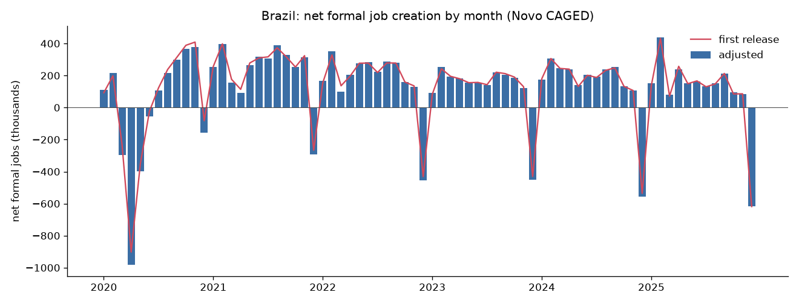
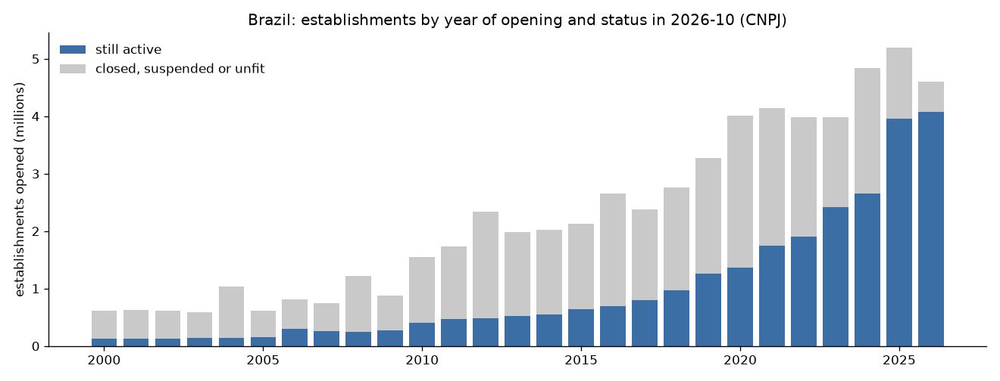

# brazil-open-data-ingest

**English** · [Português](README.pt-BR.md)

Idempotent ingestion of Brazilian government open data into partitioned Parquet:

- **Novo CAGED**: monthly formal employment microdata (Ministry of Labor, FTP server).
- **CNPJ**: the full company registry, released every month (Receita Federal, WebDAV share).

It downloads the files, checks each one against an independent count, and writes typed Parquet to a
local folder, S3 or MinIO. You can run it again at any time: work that is already done is skipped.

[](https://github.com/ErickBonruque/brazil-open-data-ingest/actions/workflows/ci.yml)

[](LICENSE)



## Results: Novo CAGED

Measured with the code in this repository on all files from 2020-01 to 2025-12 (already downloaded;
the download time is not included):

| | |
|---|---|
| Input | 212 `.7z` files (3.3 GB) |
| Rows | 261.7 million (MOV 252.9 M · FOR 8.3 M · EXC 0.6 M) |
| Output | 3.6 GB of Parquet (zstd), 212 partitions |
| Time | 16.7 min in total; about 11 s for one month of MOV (3.7 M rows) |
| Memory | 1.2 GB peak per month; 435 MB with `--memory-limit 512MB` (about 25% slower) |
| Check | row count and job balance match the source text in all 212 partitions |

Net formal jobs by year (sum of the months):

| Year | First release | Adjusted | Revision |
|---|---:|---:|---:|
| 2020 | +171,266 | −189,393 | −360,659 |
| 2021 | +2,852,413 | +2,782,295 | −70,118 |
| 2022 | +2,011,366 | +2,014,894 | +3,528 |
| 2023 | +1,478,340 | +1,455,279 | −23,061 |
| 2024 | +1,676,514 | +1,677,575 | +1,061 |
| 2025 | +1,256,997 | +1,279,498 | +22,501 |

**First release** is the balance of the MOV file of the month. **Adjusted** adds the movements that
employers declared late (FOR) and removes the movements that they cancelled later (EXC). The difference
shows the size of the corrections: in 2020 the sum of the first releases is positive, but the adjusted
balance is negative. Full tables are in [`results/`](results/).

The Parquet output is a little larger than the `.7z` input (LZMA compresses very well), but it is
columnar and typed: a query reads only the columns and partitions it needs, with no decompression step.

## Results: CNPJ



Measured on the full 2026-10 release (already downloaded; the download took 44 min, about
2.9 MB/s):

| | |
|---|---|
| Input | 37 ZIP files (7.8 GB) |
| Rows | 223.6 million: establishments 73.8 M · companies 70.5 M · Simples 50.8 M · partners 28.5 M · 6 lookup tables |
| Output | 2.0 GB of Parquet (zstd), without the personal columns |
| Time | 18 min in total; the largest file (31 M establishments) takes 5.5 min |
| Memory | 3.0 GB peak (no `--memory-limit`) |
| Check | record count matches an independent `csv` pass in all 37 partitions; check digits are valid for all 73.8 M establishments; no invalid dates |

Of the 73.8 million establishments, 28.4 million are active and 34.8 million are closed. Of the
27.0 million active head offices, 13.8 million (51%) are MEI micro-entrepreneurs. In the chart, 2026
covers January to September. Tables are in [`results/`](results/).

## Why

The data is public but hard to use. CAGED comes as `.7z` files of up to 60 MB, three per month (MOV,
FOR, EXC) that you must combine, from an FTP server with no checksums, and releases can come late
with no notice. The CNPJ registry comes as 37 headerless Latin-1 ZIP files (7.8 GB) on a file-sharing
server. This project turns both into typed tables that a scheduled job keeps up to date.

## Quick start

CAGED:

```bash
uv sync --all-extras
uv run brazil-ingest caged months                                  # months published on the FTP
uv run brazil-ingest caged ingest 2025-12 --dest data/ --state 41  # one month, Paraná only
uv run brazil-ingest caged net-jobs --dest data/ --by reference_month,state_code
```

CNPJ (the companies table is 10 files, about 1.4 GB to download):

```bash
uv run brazil-ingest cnpj releases                                   # releases on the server
uv run brazil-ingest cnpj ingest latest --dest data/ --tables cnaes,companies
```

Other destinations: `--dest s3://bucket/prefix` (needs the `s3` extra) and `--endpoint-url` for an
S3-compatible server such as MinIO. `brazil-ingest caged backfill --dest ...` ingests every month of
the last 12 months that is published and not in the destination yet.

## How it works

```
FTP / WebDAV    ->  download        ->  extract       ->  convert             ->  check             ->  destination
(.7z / .zip)        resumable,          to disk,          DuckDB, columns         own count in          Parquet + _SUCCESS.json
                    retry with          not to            by name, fixed          Python of rows        (local, S3, MinIO)
                    backoff             memory            types, filters          (and balance)
```

- **Columns by name, never by position (CAGED).** The Portuguese header (`saldomovimentação`, `salário`, ...)
  is mapped to English names. A missing required column raises `LayoutError`. The data dictionary is
  in [`layout.py`](src/brazil_ingest/caged/layout.py).
- **Independent check.** After the Parquet file is written, a plain Python pass counts the rows of the
  source text (and, for CAGED, sums the job balance). If the numbers do not match the Parquet file, nothing is published.
- **Idempotent.** Each partition gets a `_SUCCESS.json` marker, written **last**, with the row count,
  the balance, the SHA-256 of the source file and the filters used. A partition with a marker is
  skipped. A run with other filters on the same destination is refused, because it would mix two
  different subsets.
- **Safe download.** The file goes to a `.part` file, resumes from the last byte (FTP `REST`) after a
  broken connection, and is renamed only when its size matches the size the server reports.
- **Real problems found in the CAGED data:**
  - The files are UTF-8 with CRLF line ends, but much Brazilian public data still comes in Latin-1.
    The wrong encoding breaks the accents in the header and, with them, the column mapping. The reader
    detects the encoding before it starts.
  - The EXC file has 30 columns; MOV and FOR have 28. The extra columns go only into the EXC table.
  - 67 salary cells in 21 partitions use scientific notation (`1,00e+12`, which is BRL 1 trillion).
    The first version used `DECIMAL(14,2)` and failed on February 2025 with an overflow. Now the type
    is `DECIMAL(18,2)`, the value is kept as published, and the marker counts these cells for anyone
    who analyzes salaries.
  - January 2020 has only MOV. FOR starts in 2020-02 and EXC in 2020-04.

- **Real problems found in the CNPJ data:**
  - The files have no header and use Latin-1 (CAGED uses UTF-8). In one file the first accented
    name is on line 15,299, so a probe of the first megabyte said UTF-8. The reader now decides at
    the first non-ASCII byte of the file.
  - 5 bytes are in the C1 control range (for example one `0x8F` inside an email field). DuckDB's
    Latin-1 reader refuses them, so Latin-1 files are transcoded to UTF-8 first. This keeps the
    characters, and the marker counts them.
  - Files 1 to 9 of each table have exactly the same number of rows; file 0 has the rest (31 M
    establishments, 2.3 GB zipped). Plan time and disk for file 0.
  - Since July 2026 a CNPJ can contain letters. CNPJ columns are text, and the check digits are
    validated with the alphanumeric rule. The 2026-10 release has 1 alphanumeric CNPJ.
  - The municipality code is the Receita's own code, not the IBGE code. A join with CAGED needs a
    mapping table, which is not included.
  - Since 2025 the files are on a Nextcloud share. The connector reads it through WebDAV
    (`PROPFIND` to list, `GET` with `Range` to resume).

### Privacy (CNPJ)

By default the output does not include the address, phones and email of establishments, the names
and documents of partners, or the company name of individual entrepreneurs (legal nature 2135,
which includes the MEI). For them the company name is the owner's own name, and in one file I
measured that about 1% of these names also contain a CPF number. If the legal nature is missing,
the name is also hidden. `--keep-personal` keeps all columns as published.

### Output layout

```
caged/kind=mov/year=2025/month=12/part-0.parquet
caged/kind=mov/year=2025/month=12/_SUCCESS.json
caged/kind=for/...   caged/kind=exc/...
```

`year` and `month` are the **release** month (the folder on the FTP server). FOR and EXC files contain
movements of earlier months; the `reference_month` column keeps that month.

```
cnpj/table=establishments/release=2026-10/chunk=3/part-0.parquet
cnpj/table=establishments/release=2026-10/chunk=3/_SUCCESS.json
```

Each CNPJ release is a full snapshot, so old releases stay next to new ones. DuckDB, Spark, Athena
and Glue can read this Hive-style layout.

## AWS deploy (optional)

[`deploy/aws-lambda/Dockerfile`](deploy/aws-lambda/Dockerfile) builds a Lambda image that runs the
CAGED backfill into `s3://...` ([`aws_lambda.py`](src/brazil_ingest/aws_lambda.py)). With an EventBridge
schedule, the function gets each release when it is published, and catches up after a late release or
a failed run. CI builds the image on every push.

Tested end to end with the image running locally (Lambda runtime interface emulator) and a local S3
server ([moto](https://github.com/getmoto/moto)): the function downloaded the 2026-09 release from the
real FTP server (3 files, 4.4 million rows) in 57 s; the second call returned `written: 0`.

## Stack

Python 3.11+, DuckDB, Parquet, py7zr, defusedxml, boto3 (optional), pytest, ruff, mypy (strict),
GitHub Actions, Docker, uv.

## Limitations

- The FTP server publishes no checksums. The download is checked by size, and the SHA-256 is recorded
  in the marker.
- `net-jobs` reads only a local destination. For S3, use DuckDB with `httpfs` or Athena on the same
  layout.
- There is no Terraform in this repository. The image and the handler are ready, but the function,
  the bucket and the schedule are for the person who deploys it.
- The most recent months will still get corrections (FOR and EXC of later months), so their revision
  will probably grow.
- The CNPJ release is too large for AWS Lambda (file 0 alone takes 5.5 min and several GB of
  temporary disk). Run the same image as a container job (for example ECS or AWS Batch) with
  `brazil-ingest cnpj ingest latest` as the command.
- The adjusted balance is calculated here from the microdata. I did not compare it with the official
  balance tables, which are closed on their own dates.

## License

[MIT](LICENSE). The CAGED data belongs to the Ministry of Labor and Employment (PDET) and the CNPJ
data to the Receita Federal; both follow their terms of use.
