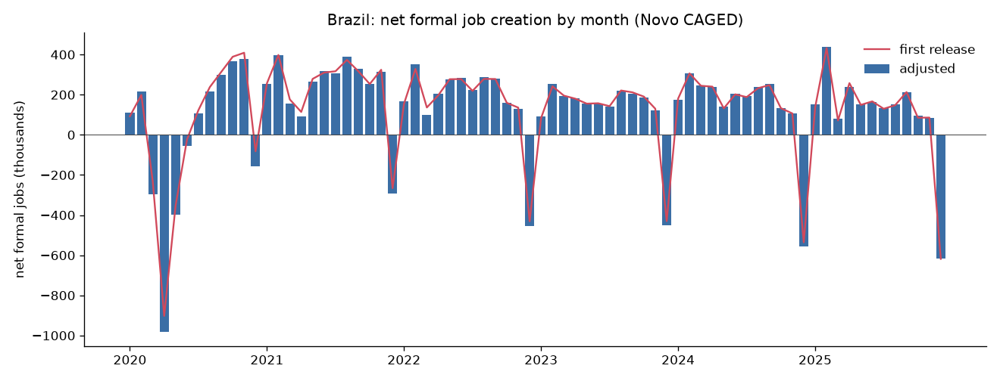

# brazil-open-data-ingest

[English](README.md) · **Português**

Ingestão idempotente dos microdados do **Novo CAGED** (emprego formal no Brasil, Ministério do
Trabalho) para Parquet particionado. Baixa os arquivos mensais do FTP do governo, confere cada um e
grava em uma pasta local, no S3 ou no MinIO. Pode rodar de novo a qualquer momento: o que já foi feito
é pulado.

[](https://github.com/ErickBonruque/brazil-open-data-ingest/actions/workflows/ci.yml)

[](LICENSE)



## Resultados

Medido com o código deste repositório sobre todos os arquivos de 2020-01 a 2025-12 (já baixados; o
download não entra no tempo):

| | |
|---|---|
| Entrada | 212 arquivos `.7z` (3,3 GB) |
| Linhas | 261,7 milhões (MOV 252,9 mi · FOR 8,3 mi · EXC 0,6 mi) |
| Saída | 3,6 GB de Parquet (zstd), 212 partições |
| Tempo | 16,7 min no total; cerca de 11 s para um mês de MOV (3,7 mi de linhas) |
| Memória | 1,2 GB de pico por mês; 435 MB com `--memory-limit 512MB` (cerca de 25% mais lento) |
| Conferência | linhas e saldo batem com o texto de origem nas 212 partições |

Saldo de empregos formais por ano, somando os meses:

| Ano | Primeira divulgação | Ajustado | Revisão |
|---|---:|---:|---:|
| 2020 | +171.266 | −189.393 | −360.659 |
| 2021 | +2.852.413 | +2.782.295 | −70.118 |
| 2022 | +2.011.366 | +2.014.894 | +3.528 |
| 2023 | +1.478.340 | +1.455.279 | −23.061 |
| 2024 | +1.676.514 | +1.677.575 | +1.061 |
| 2025 | +1.256.997 | +1.279.498 | +22.501 |

**Primeira divulgação** é o saldo do arquivo MOV do mês. **Ajustado** soma as declarações feitas fora
do prazo (FOR) e tira as exclusões (EXC) que chegaram nos meses seguintes. A diferença mostra o
tamanho das correções: em 2020, a soma das primeiras divulgações era positiva e o ajustado é
negativo. Tabelas completas em [`results/`](results/).

O Parquet ocupa um pouco mais que o `.7z` (LZMA comprime muito), mas é colunar e tipado: uma consulta lê
só as colunas e as partições que precisa, sem descompactar nada.

## Por quê

Os microdados são públicos, mas dão trabalho: um `.7z` de até 60 MB por arquivo, três arquivos por mês
(MOV, FOR, EXC) que precisam ser combinados, um FTP sem checksum e uma divulgação que pode atrasar
sem aviso. Este projeto transforma isso em uma tabela tipada, que pode ser atualizada por agendamento.

## Como rodar

```bash
uv sync --all-extras
uv run brazil-ingest caged months                                  # meses publicados no FTP
uv run brazil-ingest caged ingest 2025-12 --dest data/ --state 41  # um mês, só o Paraná
uv run brazil-ingest caged net-jobs --dest data/ --by reference_month,state_code
```

Outros destinos: `--dest s3://bucket/prefixo` (precisa do extra `s3`) e `--endpoint-url` para um
servidor compatível com S3, como o MinIO.
`brazil-ingest caged backfill --dest ...` processa todos os meses publicados nos últimos 12 meses que
ainda não estão no destino.

## Como funciona

```
FTP do governo  ->  download        ->  extração      ->  conversão           ->  conferência       ->  destino
(.7z por mês)       retomável,          para disco,       DuckDB, colunas         contagem própria       Parquet + _SUCCESS.json
                    retry com           não para          pelo nome, tipos        em Python das          (local, S3, MinIO)
                    backoff             a memória         fixos, filtros          linhas e do saldo
```

- **Colunas pelo nome, nunca pela posição.** O cabeçalho em português (`saldomovimentação`,
  `salário`...) é mapeado para nomes em inglês. Coluna obrigatória faltando gera `LayoutError`.
  Dicionário de dados em [`layout.py`](src/brazil_ingest/caged/layout.py).
- **Conferência independente.** Depois de gravar o Parquet, uma leitura em Python puro conta as linhas
  e soma o saldo do texto original. Se não bater com o Parquet, nada é publicado.
- **Idempotência.** Cada partição recebe um `_SUCCESS.json` **por último**, com linhas, saldo, SHA-256
  do arquivo de origem e filtros usados. Partição com marcador é pulada. Rodar com outro filtro no
  mesmo destino é recusado, porque misturaria recortes diferentes.
- **Download seguro.** Grava em `.part`, retoma do último byte (`REST` do FTP) depois de uma queda e só
  renomeia quando o tamanho bate com o informado pelo servidor.
- **Problemas reais encontrados nos dados:**
  - Os arquivos são UTF-8 com quebra de linha CRLF, mas muito dado público brasileiro ainda vem em
    Latin-1. Ler com a codificação errada estraga os acentos do cabeçalho e, com isso, o mapeamento
    das colunas. A leitura detecta a codificação antes de começar.
  - O arquivo EXC tem 30 colunas e o MOV e o FOR têm 28. As colunas extras só entram na tabela EXC.
  - Há 67 células de salário em notação científica (`1,00e+12`, ou seja, R$ 1 trilhão) em 21 partições.
    A primeira versão usava `DECIMAL(14,2)` e quebrou em fevereiro de 2025 por estouro. Agora é
    `DECIMAL(18,2)`, o valor é mantido como veio e o marcador conta essas células para quem for
    analisar salário.
  - Janeiro de 2020 só tem MOV. O FOR começa em 2020-02 e o EXC em 2020-04.

### Layout de saída

```
caged/kind=mov/year=2025/month=12/part-0.parquet
caged/kind=mov/year=2025/month=12/_SUCCESS.json
caged/kind=for/...   caged/kind=exc/...
```

`year` e `month` são o mês da **divulgação** (a pasta no FTP). FOR e EXC trazem movimentações de meses
anteriores, que ficam na coluna `reference_month`. O layout no estilo Hive pode ser lido pelo DuckDB,
Spark, Athena e Glue.

## Deploy na AWS (opcional)

[`deploy/aws-lambda/Dockerfile`](deploy/aws-lambda/Dockerfile) gera uma imagem de Lambda que roda o
backfill para `s3://...` ([`aws_lambda.py`](src/brazil_ingest/aws_lambda.py)). Com um agendamento no
EventBridge, a função pega cada divulgação quando ela sai e recupera os meses perdidos depois de um
atraso ou de uma falha. O CI compila a imagem a cada push.

Testado de ponta a ponta com a imagem rodando localmente (emulador de runtime da Lambda) e um servidor
S3 local ([moto](https://github.com/getmoto/moto)): a função baixou do FTP real o mês 2026-09 (3
arquivos, 4,4 milhões de linhas) em 57 s; a segunda chamada respondeu `written: 0`.

## Stack

Python 3.11+, DuckDB, Parquet, py7zr, boto3 (opcional), pytest, ruff, mypy (strict), GitHub Actions,
Docker, uv.

## Limitações

- O FTP não publica checksum. O download é conferido pelo tamanho, e o SHA-256 fica registrado no marcador.
- `net-jobs` lê só destino local. Para o S3, use o DuckDB com `httpfs` ou o Athena sobre o mesmo layout.
- Não há Terraform neste repositório. A imagem e o handler estão prontos, mas criar a função, o bucket e
  o agendamento fica com quem for fazer o deploy.
- Os meses mais recentes ainda vão receber correções (FOR e EXC dos meses seguintes), então a
  revisão deles tende a crescer.
- O saldo ajustado é calculado aqui a partir dos microdados. Não comparei com as tabelas oficiais
  de saldo, que são fechadas em datas próprias.

## Licença

[MIT](LICENSE). Os dados são do Ministério do Trabalho e Emprego (PDET) e seguem os termos de uso dele.
