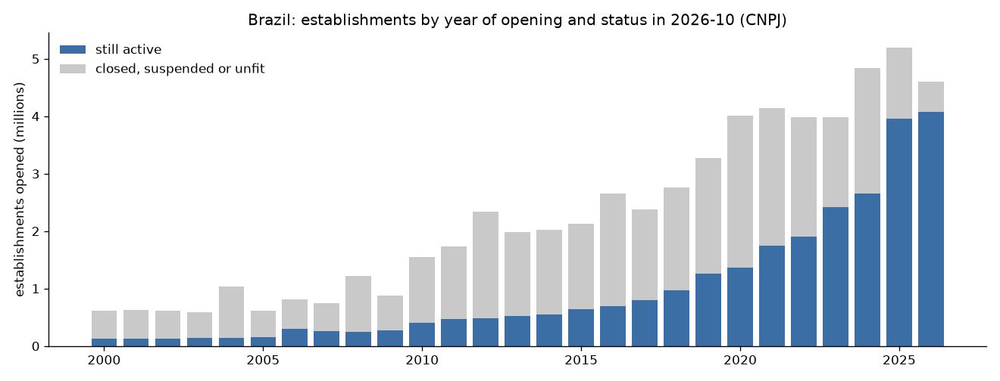

# brazil-open-data-ingest

[English](README.md) · **Português**

Ingestão idempotente de dados abertos do governo brasileiro para Parquet particionado:

- **Novo CAGED**: microdados mensais de emprego formal (Ministério do Trabalho, servidor FTP).
- **CNPJ**: o cadastro completo de empresas, divulgado todo mês (Receita Federal, compartilhamento WebDAV).

Baixa os arquivos, confere cada um contra uma contagem independente e grava Parquet tipado em uma
pasta local, no S3 ou no MinIO. Pode rodar de novo a qualquer momento: o que já foi feito é pulado.

[](https://github.com/ErickBonruque/brazil-open-data-ingest/actions/workflows/ci.yml)

[](LICENSE)


## Resultados: Novo CAGED

Medido com o código deste repositório sobre todos os arquivos de 2020-01 a 2025-12 (já baixados; o
download não entra no tempo):

| | |
|---|---|
| Entrada | 212 arquivos `.7z` (3,3 GB) |
| Linhas | 261,7 milhões (MOV 252,9 mi · FOR 8,3 mi · EXC 0,6 mi) |
| Saída | 3,6 GB de Parquet (zstd), 212 partições |
| Tempo | 16,7 min no total; cerca de 11 s para um mês de MOV (3,7 mi de linhas) |
| Memória | 1,2 GB de pico por mês; 435 MB com `--memory-limit 512MB` (cerca de 25% mais lento) |
| Conferência | linhas e saldo batem com o texto de origem nas 212 partições |

Saldo de empregos formais por ano, somando os meses:

| Ano | Primeira divulgação | Ajustado | Revisão |
|---|---:|---:|---:|
| 2020 | +171.266 | −189.393 | −360.659 |
| 2021 | +2.852.413 | +2.782.295 | −70.118 |
| 2022 | +2.011.366 | +2.014.894 | +3.528 |
| 2023 | +1.478.340 | +1.455.279 | −23.061 |
| 2024 | +1.676.514 | +1.677.575 | +1.061 |
| 2025 | +1.256.997 | +1.279.498 | +22.501 |

**Primeira divulgação** é o saldo do arquivo MOV do mês. **Ajustado** soma as declarações feitas fora
do prazo (FOR) e tira as exclusões (EXC) que chegaram nos meses seguintes. A diferença mostra o
tamanho das correções: em 2020, a soma das primeiras divulgações era positiva e o ajustado é
negativo. Tabelas completas em [`results/`](results/).

O Parquet ocupa um pouco mais que o `.7z` (LZMA comprime muito), mas é colunar e tipado: uma consulta lê
só as colunas e as partições que precisa, sem descompactar nada.

## Resultados: CNPJ



Medido sobre a divulgação completa de 2026-10 (já baixada; o download levou 44 min, cerca de
2,9 MB/s):

| | |
|---|---|
| Entrada | 37 arquivos ZIP (7,8 GB) |
| Linhas | 223,6 milhões: estabelecimentos 73,8 mi · empresas 70,5 mi · Simples 50,8 mi · sócios 28,5 mi · 6 tabelas de domínio |
| Saída | 2,0 GB de Parquet (zstd), sem as colunas pessoais |
| Tempo | 18 min no total; o maior arquivo (31 mi de estabelecimentos) leva 5,5 min |
| Memória | 3,0 GB de pico (sem `--memory-limit`) |
| Conferência | contagem de registros bate com uma leitura independente pelo `csv` nas 37 partições; dígitos verificadores válidos nos 73,8 mi de estabelecimentos; nenhuma data inválida |

Dos 73,8 milhões de estabelecimentos, 28,4 milhões estão ativos e 34,8 milhões estão baixados. Das
27,0 milhões de matrizes ativas, 13,8 milhões (51%) são MEI. No gráfico, 2026 vai de janeiro a
setembro. Tabelas em [`results/`](results/).

## Por quê

Os dados são públicos, mas dão trabalho. O CAGED vem em `.7z` de até 60 MB, três por mês (MOV, FOR,
EXC) que precisam ser combinados, de um FTP sem checksum, e a divulgação pode atrasar sem aviso. O
CNPJ vem em 37 ZIPs em Latin-1 sem cabeçalho (7,8 GB) num servidor de compartilhamento de arquivos.
Este projeto transforma os dois em tabelas tipadas, que podem ser atualizadas por agendamento.

## Como rodar

CAGED:

```bash
uv sync --all-extras
uv run brazil-ingest caged months                                  # meses publicados no FTP
uv run brazil-ingest caged ingest 2025-12 --dest data/ --state 41  # um mês, só o Paraná
uv run brazil-ingest caged net-jobs --dest data/ --by reference_month,state_code
```

CNPJ (a tabela de empresas tem 10 arquivos, cerca de 1,4 GB de download):

```bash
uv run brazil-ingest cnpj releases                                   # divulgações no servidor
uv run brazil-ingest cnpj ingest latest --dest data/ --tables cnaes,companies
```

Outros destinos: `--dest s3://bucket/prefixo` (precisa do extra `s3`) e `--endpoint-url` para um
servidor compatível com S3, como o MinIO.
`brazil-ingest caged backfill --dest ...` processa todos os meses publicados nos últimos 12 meses que
ainda não estão no destino.

## Como funciona

```
FTP / WebDAV    ->  download        ->  extração      ->  conversão           ->  conferência       ->  destino
(.7z / .zip)        retomável,          para disco,       DuckDB, colunas         contagem própria       Parquet + _SUCCESS.json
                    retry com           não para          pelo nome, tipos        em Python das          (local, S3, MinIO)
                    backoff             a memória         fixos, filtros          linhas e do saldo
```

- **Colunas pelo nome, nunca pela posição (CAGED).** O cabeçalho em português (`saldomovimentação`,
  `salário`...) é mapeado para nomes em inglês. Coluna obrigatória faltando gera `LayoutError`.
  Dicionário de dados em [`layout.py`](src/brazil_ingest/caged/layout.py).
- **Conferência independente.** Depois de gravar o Parquet, uma leitura em Python puro conta as linhas
  do texto original (e, no CAGED, soma o saldo). Se não bater com o Parquet, nada é publicado.
- **Idempotência.** Cada partição recebe um `_SUCCESS.json` **por último**, com linhas, saldo, SHA-256
  do arquivo de origem e filtros usados. Partição com marcador é pulada. Rodar com outro filtro no
  mesmo destino é recusado, porque misturaria recortes diferentes.
- **Download seguro.** Grava em `.part`, retoma do último byte (`REST` do FTP) depois de uma queda e só
  renomeia quando o tamanho bate com o informado pelo servidor.
- **Problemas reais encontrados no CAGED:**
  - Os arquivos são UTF-8 com quebra de linha CRLF, mas muito dado público brasileiro ainda vem em
    Latin-1. Ler com a codificação errada estraga os acentos do cabeçalho e, com isso, o mapeamento
    das colunas. A leitura detecta a codificação antes de começar.
  - O arquivo EXC tem 30 colunas e o MOV e o FOR têm 28. As colunas extras só entram na tabela EXC.
  - Há 67 células de salário em notação científica (`1,00e+12`, ou seja, R$ 1 trilhão) em 21 partições.
    A primeira versão usava `DECIMAL(14,2)` e quebrou em fevereiro de 2025 por estouro. Agora é
    `DECIMAL(18,2)`, o valor é mantido como veio e o marcador conta essas células para quem for
    analisar salário.
  - Janeiro de 2020 só tem MOV. O FOR começa em 2020-02 e o EXC em 2020-04.

- **Problemas reais encontrados no CNPJ:**
  - Os arquivos não têm cabeçalho e usam Latin-1 (o CAGED usa UTF-8). Num arquivo, o primeiro nome
    com acento está na linha 15.299, então olhar só o primeiro megabyte dizia UTF-8. A leitura agora
    decide no primeiro byte não-ASCII do arquivo.
  - Há 5 bytes na faixa de controle C1 (por exemplo um `0x8F` dentro de um e-mail). O leitor Latin-1
    do DuckDB recusa esses bytes, então os arquivos Latin-1 são convertidos para UTF-8 antes. Os
    caracteres são mantidos e o marcador conta quantos são.
  - Os arquivos 1 a 9 de cada tabela têm exatamente o mesmo número de linhas; o arquivo 0 fica com o
    resto (31 mi de estabelecimentos, 2,3 GB compactado). Planeje tempo e disco pelo arquivo 0.
  - Desde julho de 2026 o CNPJ pode ter letras. As colunas de CNPJ são texto e os dígitos
    verificadores são conferidos com a regra alfanumérica. A divulgação 2026-10 tem 1 CNPJ alfanumérico.
  - O código de município é o da própria Receita, não o do IBGE. Cruzar com o CAGED exige uma tabela
    de correspondência, que não está incluída.
  - Desde 2025 os arquivos estão num compartilhamento Nextcloud. O conector lê via WebDAV
    (`PROPFIND` para listar, `GET` com `Range` para retomar).

### Privacidade (CNPJ)

Por padrão, a saída não traz endereço, telefones e e-mail dos estabelecimentos, nome e documento dos
sócios, nem a razão social de empresário individual (natureza jurídica 2135, que inclui o MEI). Nesses
casos a razão social é o nome do próprio dono, e num arquivo medi que cerca de 1% desses nomes também
traz o número do CPF. Se a natureza jurídica estiver vazia, o nome também é escondido.
`--keep-personal` mantém todas as colunas como foram publicadas.

### Layout de saída

```
caged/kind=mov/year=2025/month=12/part-0.parquet
caged/kind=mov/year=2025/month=12/_SUCCESS.json
caged/kind=for/...   caged/kind=exc/...
```

`year` e `month` são o mês da **divulgação** (a pasta no FTP). FOR e EXC trazem movimentações de meses
anteriores, que ficam na coluna `reference_month`.

```
cnpj/table=establishments/release=2026-10/chunk=3/part-0.parquet
cnpj/table=establishments/release=2026-10/chunk=3/_SUCCESS.json
```

Cada divulgação do CNPJ é uma foto completa, então as antigas ficam ao lado das novas. O layout no
estilo Hive pode ser lido pelo DuckDB, Spark, Athena e Glue.

## Deploy na AWS (opcional)

[`deploy/aws-lambda/Dockerfile`](deploy/aws-lambda/Dockerfile) gera uma imagem de Lambda que roda o
backfill do CAGED para `s3://...` ([`aws_lambda.py`](src/brazil_ingest/aws_lambda.py)). Com um agendamento no
EventBridge, a função pega cada divulgação quando ela sai e recupera os meses perdidos depois de um
atraso ou de uma falha. O CI compila a imagem a cada push.

Testado de ponta a ponta com a imagem rodando localmente (emulador de runtime da Lambda) e um servidor
S3 local ([moto](https://github.com/getmoto/moto)): a função baixou do FTP real o mês 2026-09 (3
arquivos, 4,4 milhões de linhas) em 57 s; a segunda chamada respondeu `written: 0`.

## Stack

Python 3.11+, DuckDB, Parquet, py7zr, defusedxml, boto3 (opcional), pytest, ruff, mypy (strict),
GitHub Actions, Docker, uv.

## Limitações

- O FTP não publica checksum. O download é conferido pelo tamanho, e o SHA-256 fica registrado no marcador.
- `net-jobs` lê só destino local. Para o S3, use o DuckDB com `httpfs` ou o Athena sobre o mesmo layout.
- Não há Terraform neste repositório. A imagem e o handler estão prontos, mas criar a função, o bucket e
  o agendamento fica com quem for fazer o deploy.
- Os meses mais recentes ainda vão receber correções (FOR e EXC dos meses seguintes), então a
  revisão deles tende a crescer.
- A divulgação do CNPJ é grande demais para a Lambda (só o arquivo 0 leva 5,5 min e vários GB de
  disco temporário). Rode a mesma imagem como job de container (por exemplo ECS ou AWS Batch) com
  `brazil-ingest cnpj ingest latest` como comando.
- O saldo ajustado é calculado aqui a partir dos microdados. Não comparei com as tabelas oficiais
  de saldo, que são fechadas em datas próprias.

## Licença

[MIT](LICENSE). Os dados do CAGED são do Ministério do Trabalho e Emprego (PDET) e os do CNPJ são da
Receita Federal; os dois seguem os termos de uso de cada órgão.
